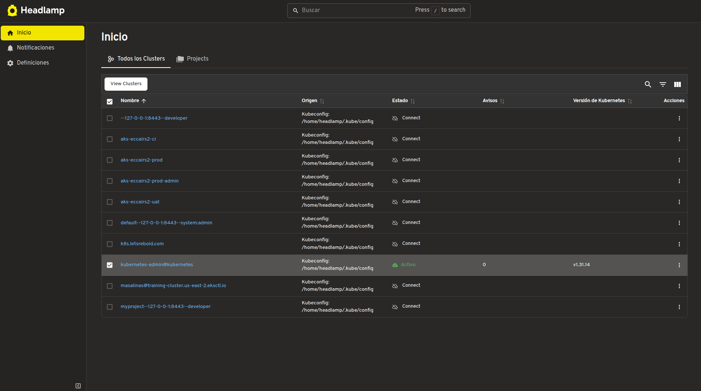
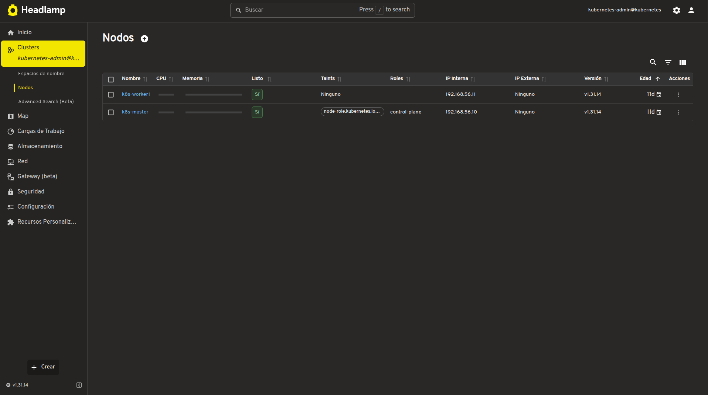

# Description
DoC Deploy Kubernetes Management Headlamp using Docker

## Steps

- **STEP01**: Deploy Headlamp docker container:

```shell
docker run --name headlamp -d \
  -p 4466:4466 \
  --user $(id -u):$(id -g) \
  -v ~/.kube:/home/headlamp/.kube:ro \
  ghcr.io/headlamp-k8s/headlamp:latest \
  -in-cluster=false \
  -kubeconfig=/home/headlamp/.kube/config
115999f1d9e4dfe84c467e498e1c560fd195492b928af80398477d3c3a5a9245
```

- **STEP02**: Open Headlamp and select a cluster
  

```shell
http://localhost:4466
```

Select a cluster from list


List nodes for your cluster selected

